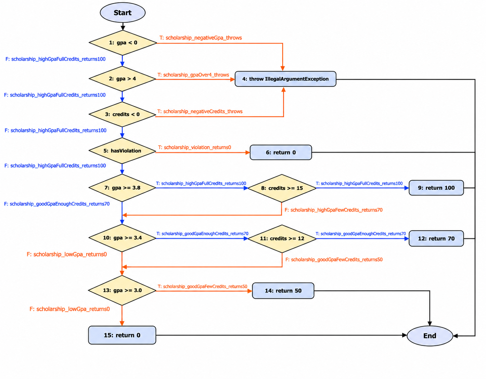

# Лаб 9: Код хамралт, JaCoCo

Д.Ууганбаяр, b232270004
F.CSA313 Программ хангамжийн чанарын баталгаа ба туршилт

## Орчин

```
$ java -version
openjdk version "17.0.16" 2025-07-15
OpenJDK Runtime Environment Homebrew (build 17.0.16+0)
OpenJDK 64-Bit Server VM Homebrew (build 17.0.16+0, mixed mode, sharing)
$ mvn -version
Apache Maven 3.9.14 (996c630dbc656c76214ce58821dcc58be960875b)
Maven home: /Users/uugnaa/.sdkman/candidates/maven/current
Java version: 17.0.16, vendor: Homebrew, runtime: /opt/homebrew/Cellar/openjdk@17/17.0.16/libexec/openjdk.jdk/Contents/Home
Default locale: en_MN, platform encoding: UTF-8
OS name: "mac os x", version: "26.5.2", arch: "aarch64", family: "mac"
```

JUnit 5.10.2, JaCoCo 0.8.12 (starter-ийн pom.xml). Starter дээр `mvn verify` ажиллуулахад `No tests to run.` ба `Skipping JaCoCo execution due to missing execution data file.` гарч, тайлан үүсээгүй.

## Хэсэг A: Happy path

[ScholarshipCalculatorTest.java](src/test/java/mn/edu/must/sqat/ScholarshipCalculatorTest.java)-д хэвийн урсгалын 5 тест: `letterGrade(95)="A"`, `letterGrade(85)="B"`, `gpa([95, 85])=3.5`, `scholarship(3.9, 16, false)=100`, `scholarship(3.5, 12, false)=70`.

```bash
mvn verify 2>&1 | tee results/mvn-verify-A.txt
cp target/site/jacoco/jacoco.csv results/jacoco-A.csv
```

[results/jacoco-A.csv](results/jacoco-A.csv): LINE_COVERED 15, LINE_MISSED 10, BRANCH_COVERED 20, BRANCH_MISSED 21.

- Line: 15 / 25 = 60%
- Branch: 20 / 41 = 48.8%

Шар мөрүүд нь нөхцөлийн зөвхөн нэг тал нь ажилласан газар: 52-р мөрийн `gpa >= 3.8 && credits >= 15`-д голч хүрсэн ч кредит дутуу тохиолдол байхгүй, 36-р мөрийн switch-д зөвхөн A, B case орж C, D, default ороогүй. Улаан мөрүүд нь гурван `throw` (21, 32, 49-р мөр) буюу алдааны зам бүгд, мөн C, D, F дүн, 50 ба 0 хувийн тэтгэлэг. Happy path тестүүд зөвхөн өндөр оноо, өндөр голчтой оролт өгсөн тул доод шатны салаа руу нэг ч тест ороогүй.

## Хэсэг B: CFG ба 100% хамралт



`scholarship()`-ийн CFG-д `||`, `&&` нөхцөлийн хэсэг бүрийг тусдаа зангилаа болгосон, учир нь JaCoCo нөхцөл бүрийг тусдаа салаа гэж тоолдог (9 нөхцөл, 18 салаа). Ирмэг бүр дээр түүнийг дайрдаг тестийн нэрийг бичсэн, хамрагдаагүй ирмэгүүдээс доорх тестүүд гарсан. Улбар шар ирмэгүүд нь A-гийн дараа хамрагдаагүй байсан 9 салаа (JaCoCo-ийн A тайлангийн 48, 51, 52, 53, 54-р мөрийн алгассан салаанууд).

Нэмсэн 15 тест:

- `letterGrade`: 0-ээс бага ба 100-аас их оноог тус тусад нь `assertThrows`, C (75), D (65), F (50)
- `gpa`: `null`, хоосон массив, `[75, 65, 50] = 1.0` (switch-ийн C, D, default салаа)
- `scholarship`: `gpa < 0`, `gpa > 4`, `credits < 0` гурвыг гурван тусдаа `assertThrows`, зөрчилтэй бол 0, `3.9 / 14 = 70`, `3.5 / 10 = 50`, `2.5 / 15 = 0`

`3.9 / 14` тест нь голч 3.8 хүрсэн ч кредит дутуу буюу 52-р мөрийн `credits >= 15` худал салааг хамруулдаг, үүнгүйгээр Branch 40/41 дээр зогсох байсан.

```bash
mvn verify 2>&1 | tee results/mvn-verify-B.txt
cp target/site/jacoco/jacoco.csv results/jacoco-B.csv
```

[results/mvn-verify-B.txt](results/mvn-verify-B.txt): `Tests run: 20, Failures: 0, Errors: 0, Skipped: 0`, A-гийн 5 дээр 15 нэмж нийт 20 тест шаардагдсан. [results/jacoco-B.csv](results/jacoco-B.csv): BRANCH_MISSED 0, BRANCH_COVERED 41, LINE_MISSED 0, LINE_COVERED 25, тэгэхээр Branch 41/41 = 100%, Line 25/25 = 100%.

## Хэсэг C: Давталтын зааг

`gpa()` доторх давталтад 0 / 1 / 2+ дүрмээр 3 тест нэмсэн:

| Давталт | Тест | Шалгалт |
|---|---|---|
| 0 удаа | `gpa_loopZero_emptyAndNull_throw` | хоосон массив ба `null` хоёулаа `assertThrows(IllegalArgumentException)` |
| 1 удаа | `gpa_loopOne_95_returns4` | `gpa([95]) == 4.0` |
| 2+ удаа | `gpa_loopMany_95_85_75_65_returns2_5` | `gpa([95, 85, 75, 65]) == 2.5` |

Эдгээр тест хамралтыг өсгөөгүй, учир нь давталтын орох, гарах салаа B-ийн тестүүдээр аль хэдийн хамрагдсан, гэхдээ хамралт салаа бүр дор хаяж нэг удаа дайрагдсан эсэхийг л хэмждэг, давталт 0, 1, олон удаа эргэхэд үр дүн зөв эсэхийг хэмждэггүй. Жишээ нь давталт эхний дүнг алгасдаг off-by-one алдаа гарвал `gpa([95]) == 4.0` тест 0 гэсэн хариугаар шууд унана, тиймээс давталтын заагийг хамралтаас үл хамааран тусад нь шалгах хэрэгтэй.
